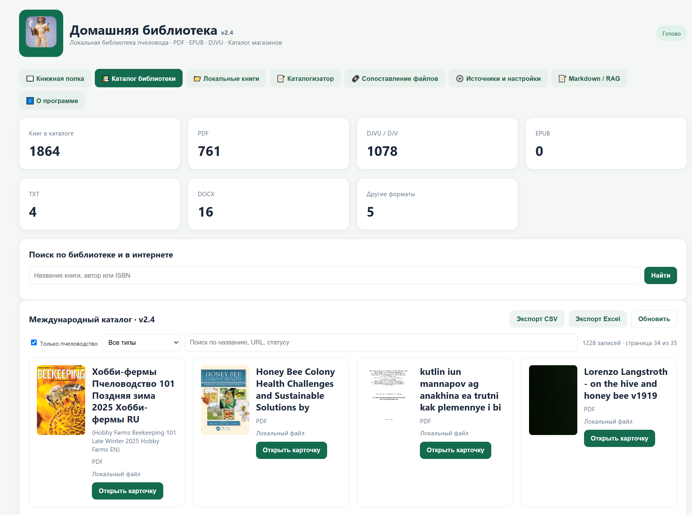
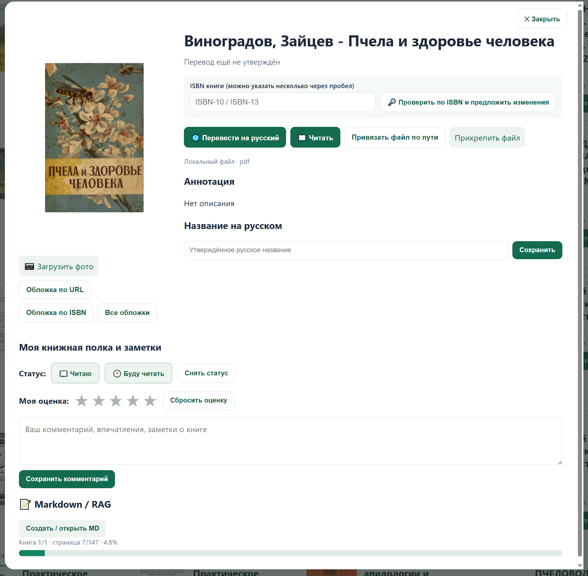
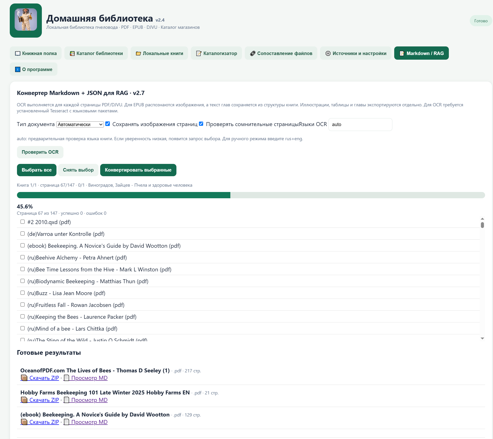

# Домашняя библиотека / HomeLibrary

Локальная библиотека электронных книг для Windows и Linux: каталогизация, чтение, поиск, объединение нескольких файлов одной книги и конвертация в Markdown/JSON для RAG.


## Возможности v2.7

- Импорт PDF, EPUB, DJVU и других поддерживаемых форматов; карточки и обложки.
- Группировка нескольких файлов одной книги и выявление похожих записей.
- OCR через Tesseract, экспорт Markdown и JSON-фрагментов для RAG.
- Массовая конвертация и создание PDF из фотографий страниц.
- Резервное копирование и восстановление каталога.

## Скриншоты

### Каталог книг


### Карточка книги


### Конвертер Markdown / RAG


## Запуск из исходников

Требуется Python 3.11–3.13 (для CI используется 3.12).

**Windows:** запустите `START_WINDOWS.bat`. Он создаёт виртуальное окружение и устанавливает зависимости из `requirements.txt`.

**Linux:**
```bash
python3 -m venv .venv
source .venv/bin/activate
python -m pip install -r requirements.txt
python app.py
```

Для OCR требуется Tesseract и языковые пакеты, для обработки DJVU — инструменты DjVuLibre. Эти внешние компоненты могут не входить в собранный Portable/AppImage.

## Автоматическая сборка

GitHub Actions собирает **Windows Portable ZIP** и **Linux Portable tar.gz + AppImage** при push в `main`, при pull request и вручную.

Откройте [Actions → Build HomeLibrary](https://github.com/romirin005/HomeLibrary/actions/workflows/build.yml) → **Run workflow**. После успешного выполнения скачайте архивы из раздела **Artifacts** конкретного запуска.

Артефакты CI являются тестовыми сборками, а не подписанными релизами. Перед публичным распространением проверьте запуск на чистой Windows и Linux, OCR, DJVU, резервное копирование и миграцию данных.

## Лицензия

Исходный код распространяется на условиях [GNU GPL v3.0](LICENSE) (GPL-3.0-only), в пределах прав правообладателя. Книги, сторонние изображения и материалы пользователей не лицензируются автоматически.

## Безопасность и вклад

Не публикуйте личные книги, базы, резервные копии и секреты. Предложения и исправления приветствуются — см. [CONTRIBUTING.md](CONTRIBUTING.md).
